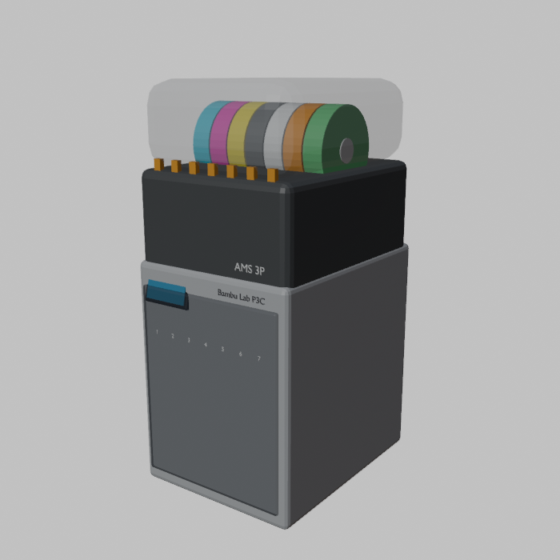

# Bambu Lab P3C — AR placement model (USDZ)

True-scale USDZ model of the Bambu Lab P3C with AMS 3P on top (Combo).
Download the USDZ and open it on an iPhone/iPad to place the printer in your room at real size with AR Quick Look.

## File

- `P3C_Combo_413x538x935mm.usdz`

## Specs

- Combo size: 413 (W) × 538 (D) × 935 (H) mm, 26.5 kg
- Printer body alone: 413 × 538 × 540 mm
- AMS 3P alone: 405 × 505 × 425 mm (mounts on top of the printer)
- Build volume: 256 × 256 × 260 mm
- Recommended installation space (official): 513 × 960 × 1,212 mm

Dimensions are from the official Bambu Lab Japan store FAQ.
This is an unofficial, simplified recreation made for placement checking only — not affiliated with Bambu Lab.
